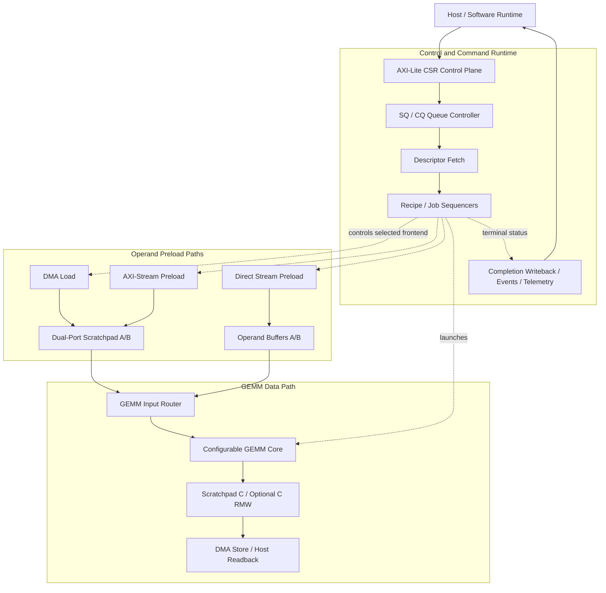

# AI Accelerator Subsystem for GEMM Workloads

A **SystemVerilog RTL and UVM 1.2 verification project** that integrates a configurable GEMM compute engine with memory-backed data movement, hardware job sequencing, and a software-facing command/completion runtime.

The project focuses on **subsystem design, integration, and verification** rather than a standalone matrix-multiply kernel: operands arrive through multiple frontends, GEMM results are stored and returned to the host, and the control plane supports queued execution, completion reporting, and recovery.

## Verification at a Glance

| Metric | Validated result |
| --- | --- |
| Full UVM regression | **150 / 150 PASS** |
| Planned functional coverage | **100.00%** across 7 covergroup domains; 0 missing planned bins |
| Full synthesizable-RTL code coverage (RAW BCEFST) | **74.83%** |
| Exclusion-aware EFFECTIVE BCEFST | **77.34%** |
| Statement coverage (RAW / EFFECTIVE) | **96.42% / 99.70%** |
| Independent fresh-checkout qualification | **PASS**: compile, regression, functional coverage, and RAW code-coverage reproduction |

> **Coverage scope:** The 100% figure is closure of the **defined and validated planned functional coverage**, not exhaustive coverage of all inputs or configurations. The **RAW** code-coverage result is authoritative; **EFFECTIVE** is a separate audit of an isolated UCDB copy using the frozen approved exclusion ledger. The final C1.3 campaign introduced **no new exclusions**.

For detailed metrics, coverage evidence, and the exclusion rationale, see the [Verification Coverage Specification](docs/verification_coverage_spec.md).

## High-Level Architecture

*Conceptual control/data-flow diagram, not a cycle-accurate wiring diagram. DMA, AXI-Stream, and Direct Stream are alternative operand-preload paths. Host-primary operation is also supported. Completion records provide per-command status; events are summary notifications.*

### Execution Paths

| Input mode | A/B operand storage | Result path |
| --- | --- | --- |
| Host-primary | Scratchpad A/B | Scratchpad C → host readback |
| DMA load | Scratchpad A/B | Scratchpad C → DMA store |
| AXI-Stream preload | Scratchpad A/B | Scratchpad C → DMA store |
| Direct Stream preload | Local operand buffers A/B | Scratchpad C → DMA store |

With optional **C read-modify-write (RMW)** accumulation, later partial-K jobs can read the previous scratchpad C value and accumulate another partial result before writing back.

## Design Highlights

### GEMM Compute

- Signed **INT8** A/B operands, signed **INT32** accumulation and results, and compact row-major matrices.
- Parameterized **1, 2, and 4-lane K-parallel MAC** configurations; the default remains the single-lane baseline.
- Optional B cache, A-row cache, and packed operand preloads (four INT8 operands per aligned 32-bit read).
- Composable **K/N/M tiling** for dimensions exceeding local cache/tile capacities.
- Optional external partial-K accumulation through C RMW, with representative frontend and recipe verification.
- Performance counters for busy cycles, logical MAC operations, and generated outputs.

### Data Movement and Storage

- Dual-port BRAM scratchpad with host/DMA/GEMM port arbitration.
- DMA load/store, AXI-Stream preload, and Direct Stream input into dedicated operand buffers.
- CDC-aware frontend integration, reset handling, error propagation, and recovery behavior.

### Programmable Control and Host Runtime

- **AXI-Lite CSR** control plane, CSR-resident job descriptors, and hardware job/recipe sequencers.
- Memory-backed descriptor fetch and completion-record writeback.
- Host-visible **submission/completion queues (SQ/CQ)** with **one active command at a time** and **in-order completion**.
- Runtime doorbells, CQ-full backpressure, queue stop/restart, and watchdog timeout handling.
- Event/interrupt-lite notification, threshold/timer-based interrupt moderation, and runtime telemetry.
- Memory-range guards and a documented driver-facing bring-up/recovery contract.

The runtime is an RTL/UVM **prototype**, not an implemented OS driver; it deliberately does not claim multi-queue or out-of-order execution.

## Verification

The UVM environment combines transaction monitors, a reference-result **scoreboard**, host and frontend memory models, AXI-MM traffic checking, passive CSR observation, and requirement-driven functional coverage.

The 150-item regression exercises representative functional, stress, CDC, configuration, reject/error, timeout, reset, and recovery scenarios. Functional coverage is organized around seven validated domains:

- Control events, job profiles, and static configurations.
- Queue runtime, event moderation, memory access guards, and telemetry.

**Code coverage:** The C1.3 sign-off reports **74.83% RAW BCEFST** and **77.34% EFFECTIVE BCEFST**. These are **different accounting views**, not two independent simulation achievements. Remaining structural gaps and approved exclusions are documented in the [coverage specification](docs/verification_coverage_spec.md). Toggle coverage is **29.81%** (RAW and EFFECTIVE); no toggle exclusions were introduced.

**Reproducibility:** An independent clean Git checkout successfully recompiled the design and repeated the full regression, planned functional coverage, and RAW code-coverage collection. Frozen historical UCDB hashes belong to the original sign-off artifacts and are not expected to match byte-for-byte across fresh simulator runs.

The canonical regression inventory is [`sim/uvm_regression.list`](sim/uvm_regression.list); [`sim/run_full_uvm_regression.tcl`](sim/run_full_uvm_regression.tcl) parses this list instead of maintaining a second hard-coded test inventory.

## Documentation

| Reference | Contents |
| --- | --- |
| [AXI-Lite CSR Control Plane Specification](docs/axi_lite_csr_control_plane_spec.md) | Canonical CSR address map, register fields, access policy and reset values |
| [Driver Runtime ABI Prototype Specification](docs/driver_runtime_abi_prototype_spec.md) | SQ/CQ ownership, software bring-up, event handling and recovery contract |
| [Verification Coverage Specification](docs/verification_coverage_spec.md) | Validation scope, metrics, exclusions, closure evidence and reproduction |
| [Functional Coverage Summary](sim/coverage/rc_cov/rc_cov_summary.txt) | Tracked planned functional coverage evidence |
| [RTL Code Coverage Summary](sim/coverage/code_cov/code_cov_summary.txt) | Tracked RAW code-coverage evidence |

## Scope and Limitations

This project is a **simulation-validated RTL/UVM subsystem** intended for digital-design and design-verification study and portfolio demonstration. The verified results apply to the implemented and tested configurations; they do not imply exhaustive parameter/protocol coverage, FPGA deployment, ASIC tapeout, timing closure, or measured PPA performance.

